  

# 🏭 Global Semiconductor Fab Count by Country & ASML Lithography Status

A comprehensive, curated dataset detailing the global distribution of semiconductor fabrication plants (**fabs**), operating counts by country/region, **ASML lithography equipment status** (EUV vs. DUV), and major domestic semiconductor manufacturers.

---

## 📌 Table of Contents
- [🌐 Overview](#-overview)
- [📊 Global Semiconductor Fab Statistics](#-global-semiconductor-fab-statistics)
- [💡 Key Insights & Terminology](#-key-insights--terminology)
- [🔍 Keywords](#-keywords)
- [🤝 Contributing](#-contributing)
- [💖 Support & Sponsorship](#-support--sponsorship)
- [📈 Star History](#-star-history)
- [📜 License](#-license)

---

## 🌐 Overview

Semiconductor manufacturing capability is a critical benchmark for technological sovereignty, geopolitics, and global supply chain resilience. This repository tracks active and operational front-end semiconductor fabrication plants across key markets including Taiwan, Japan, the United States, China, South Korea, Germany, and emerging hubs like India.

---

## 📊 Global Semiconductor Fab Statistics

| 🌍 Country / Region | 🏭 Operating Fabs Count | 🔬 ASML Lithography Equipment Status | 🏢 Major Domestic Fabs & Specialties |
| :--- | :---: | :--- | :--- |
| **Japan** | 96 | **DUV Only** *(EUV incoming)* | Sony, Kioxia, Renesas, Rapidus (2nm EUV line). |
| **Taiwan** | 79 | **EUV & DUV** | TSMC, UMC, Vanguard, Powerchip. Global advanced logic leader. |
| **United States** | 78 | **EUV & DUV** | Intel, Micron, GlobalFoundries, Texas Instruments. |
| **China** | 77 | **DUV Only** *(EUV Banned)* | SMIC, Hua Hong, CXMT, YMTC. Extensive mature-node fleet. |
| **Germany** | 20 | **DUV Only** *(EUV via ESMC JV)* | Infineon, Bosch, GlobalFoundries Fab 1, X-FAB. |
| **Singapore** | 17 | **DUV Only** | GlobalFoundries, SSMC, UMC, Micron. |
| **South Korea** | 16 | **EUV & DUV** | Samsung Electronics, SK Hynix. Cutting-edge memory & logic. |
| **Russia** | 15 | **Legacy DUV / Older Steppers** *(Sanctioned)* | Mikron (Zelenograd), NM-Tech/Angstrem-T, Pulsar. Primarily 65nm–180nm+ mature/defense silicon; cut off from ASML servicing and new tools due to sanctions. |
| **United Kingdom** | 14 | **DUV & Specialty Lithography** | Newport Wafer Fab (Vishay), Clas-SiC, Pragmatic, Diodes Inc. Compound, power, and analog chips. |
| **Malaysia** | 6 | **DUV Only** | SilTerra, X-FAB Sarawak. Specialized analog/mixed-signal (outside Malaysia's extensive OSAT/packaging base). |
| **Canada** | 4 | **Older DUV / Specialty Lithography** | Teledyne DALSA (Bromont, QC), Teledyne Micralyne (Edmonton), C2MI. Focuses heavily on MEMS, photonics, and CCD image sensors. |
| **Israel** | 3 | **DUV Only** | Intel (Fab 28/Kiryat Gat), Tower Semiconductor. |
| **France** | 3 | **DUV Only** | STMicroelectronics (Crolles 300mm), Soitec. Automotive, FD-SOI, and microcontrollers. |
| **Austria** | 2 | **DUV Only** | Infineon Technologies (Villach 300mm power fab). |
| **Ireland** | 2 | **EUV & DUV** | Intel Fab 34 (Leixlip). Europe’s only operational high-volume EUV processor fab. |
| **Italy** | 2 | **DUV Only** | STMicroelectronics (Agrate 300mm, Catania SiC). |
| **Netherlands** | 2 | **DUV Only** | NXP Semiconductors (Nijmegen). RF and automotive silicon. |
| **Australia** | 2 | **Older Steppers / Specialty** | Silanna Semiconductor (Brisbane/Sydney), Australian National Fabrication Facility (ANFF). Compound semiconductors, GaN, and power electronics. |
| **Brazil** | 1 | **Older Lithography** *(No modern ASML)* | CEITEC (Porto Alegre). The only operational front-end silicon wafer fab in Latin America, focused on RFID, sensors, and analog chips (350nm–600nm). |
| **India** | 1 | **DUV Only** *(Ordered)* | Tata Electronics / Powerchip JV (Dholera 300mm), plus CG Semi & compound fabs under the India Semiconductor Mission. |

---

## 💡 Key Insights & Terminology

- 🟣 **EUV (Extreme Ultraviolet Lithography)**: Next-generation lithography required for sub-7nm process nodes, exclusively produced by ASML (Netherlands).
- 🔵 **DUV (Deep Ultraviolet Lithography)**: Standard lithography technology used for mature and advanced nodes (down to 7nm using multi-patterning).
- ⚙️ **Front-End Fab vs. OSAT**: Front-end fabs manufacture integrated circuit (IC) silicon wafers, distinct from back-end OSAT (Outsourced Semiconductor Assembly and Test) packaging plants.

---

## 🔍 Keywords

`semiconductor fabs`, `chip manufacturing by country`, `ASML EUV DUV status`, `TSMC fabs count`, `Intel fabs`, `Samsung semiconductor`, `global chip supply chain`, `silicon wafer fabrication plants`

---

## 🤝 Contributing

Contributions, updates, and corrections to fab counts and lithography statuses are welcome! Please open an issue or pull request with credible references.

---

## 💖 Support & Sponsorship

If you find this dataset helpful and informative, please consider giving it a ⭐ **Star**, sharing it with your network, or forking it! 

Your support is greatly appreciated and helps maintain open-source data initiatives. You can also buy me a coffee via the Sponsor link below:

👉 **[Sponsor & Support on GitHub](https://github.com/sponsors/ishandutta2007)** ☕

---

## 📈 Star History

---

## 📜 License

This dataset is available under the [MIT License](LICENSE).

